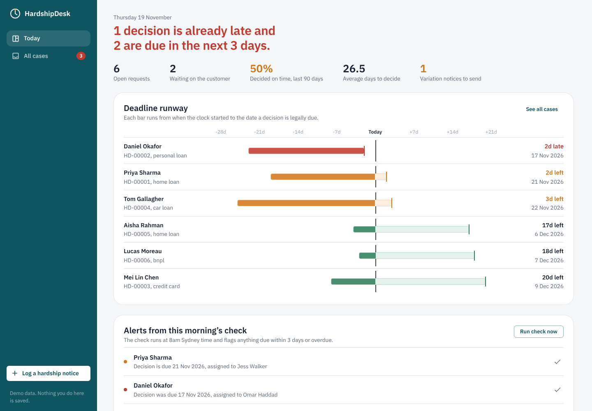
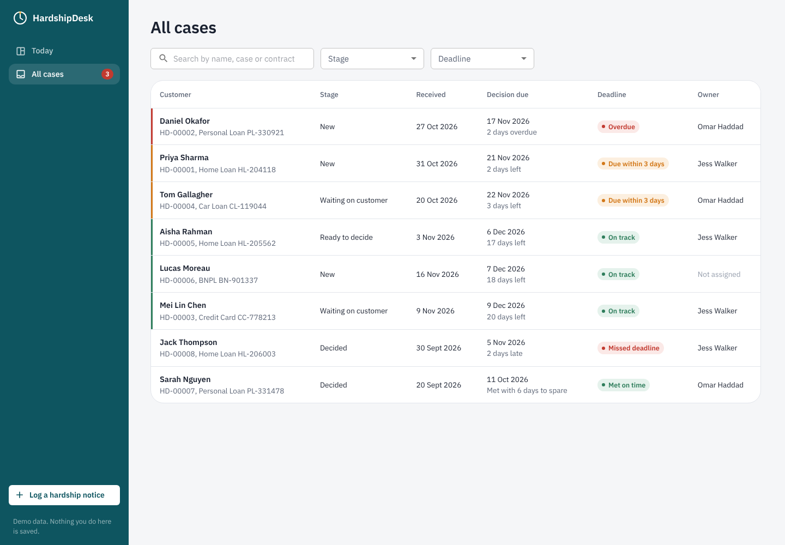
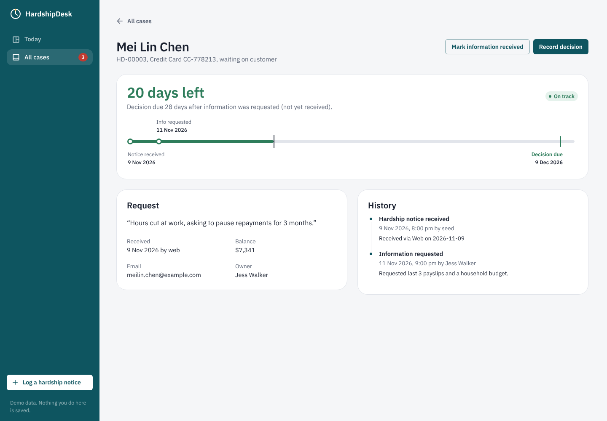
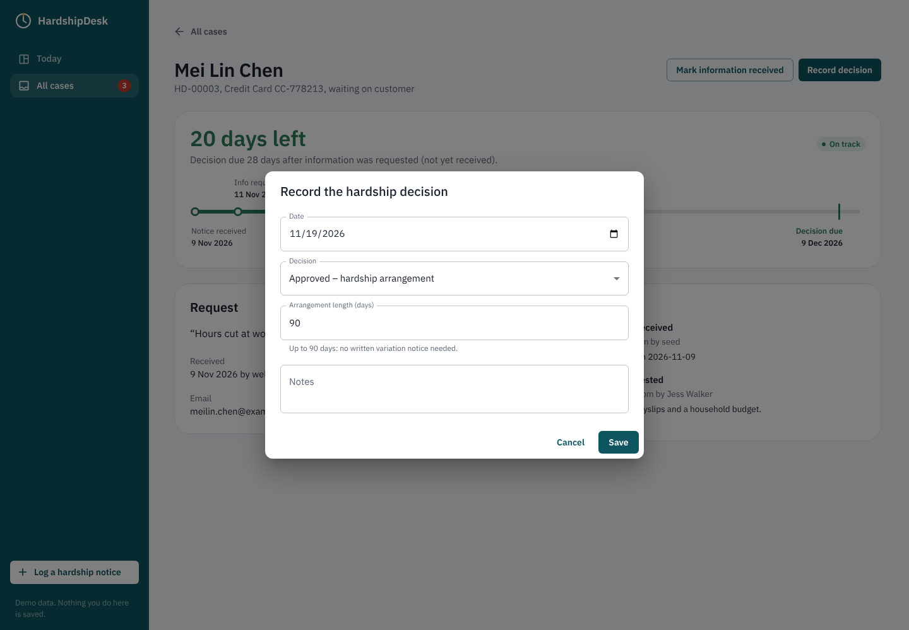

# ⏱ HardshipDesk

**A CRM for credit providers that makes sure no customer's hardship request misses its legal deadline.**

React + Redux + TypeScript + MUI · ASP.NET Core 8 Web API (C#) · SQL Server + T-SQL stored procedures · Hangfire · Redgate Flyway migrations · Azure DevOps CI/CD



## The problem

When a customer tells their lender they can't make repayments, that's a **hardship notice** under section 72 of the National Credit Code, and the lender has to act within strict timeframes:

| Situation | Deadline |
|---|---|
| Lender wants more information | Must ask within **21 days** of receiving the notice |
| No information requested | Decision within **21 days** of the notice |
| Information requested and received | Decision within **21 days** of receiving it |
| Information requested, never received | Decision within **28 days** of the request |
| Approved arrangement longer than 90 days | Written variation notice within **30 days** |

The notice can come in **by phone, email, a web form, a broker or a branch**, and the clock starts anyway. Tracking that in spreadsheets and inboxes goes wrong at scale:

- **NAB** was ordered to pay a **$15.5 million** penalty for failing to respond to hardship notices on time.
- ASIC took **Westpac** to court over **229 online hardship notices** that weren't answered within 21 days.

HardshipDesk logs every notice the moment it arrives, works out the correct legal deadline as the case changes, warns the team before a deadline is missed, and keeps a full audit trail for the regulator.

## What it does

- **Live statutory clock per case.** The deadline recalculates automatically when information is requested or received, and the rule applied is shown in plain English.
- **Blocks illegal actions.** You can't request information after day 21. The API rejects it and so does the database.
- **Morning deadline sweep (Hangfire).** A recurring job runs at **8am Sydney time** and raises alerts for cases due within 3 days or already overdue, plus missing variation notices. It's idempotent, so retries never duplicate alerts.
- **Deadline runway.** The home screen draws every open case as a bar running toward its legal deadline, with a line for today, so the team can see at a glance which decisions are late or nearly due. A plain-English headline sums up the day.
- **Compliance figures.** Open requests, cases waiting on the customer, the on-time rate over 90 days, and average days to decide.
- **Audit trail.** Every action is recorded with who did it and when.

| Case list | Case detail with the s72 timeline | Recording a decision |
|---|---|---|
|  |  |  |

The UI is built with MUI, using a custom theme (IBM Plex Sans with tabular figures and a deep petrol palette). Colour is used only to show deadline risk. The layout is responsive down to phone size and supports keyboard navigation.

## Architecture

```
React (Redux Toolkit + RTK Query, MUI)
        │  REST / JSON
ASP.NET Core 8 Web API (C#) ── Hangfire server (recurring 8am deadline job)
        │  Dapper → stored procedures only
SQL Server ── tables, inline TVF for the deadline rules, T-SQL procedures
        ▲
Redgate Flyway versioned migrations (V001, V002, V003)
```

### Design decisions

- **The deadline rules live in the database** (`dbo.tvf_CaseClock`, an inline table-valued function), so reports, the dashboard and the Hangfire sweep all use the same logic. They're mirrored in `StatutoryClock.cs` for request validation and **unit-tested with xUnit**.
- **Stored procedures only.** The API never builds SQL strings, so it's parameterised end to end. Business-rule violations are raised with `THROW 50xxx` and mapped to clean `409`/`404` responses. Unexpected errors return a generic `500` that doesn't leak SQL.
- **Business-day correctness.** "Today" is calculated in `Australia/Sydney`, not UTC, so a notice received at 9am AEDT isn't counted as the previous day.
- **Defence in depth.** Rules are enforced by UI checks, then API validation, then T-SQL checks, then table `CHECK` constraints.
- **Performance.** A covering index serves the open-case queries. The catch-all search procedure uses `OPTION (RECOMPILE)` to avoid bad cached plans.
- **Security.** It uses DataAnnotations validation, a CORS allow-list, rate limiting (120 requests/min), security headers, HSTS, and a Hangfire dashboard that only accepts local connections in development. In production I'd put it behind **Cloudflare** (reverse proxy + WAF rules + a Zero Trust Access policy for staff) and add Entra ID sign-in.

## Run it

### Option 1: UI demo only (no database needed)

```bash
cd frontend
npm install
npm run dev:demo      # http://localhost:5173
```

Demo mode runs an in-browser copy of the API with sample data. This is also what the GitHub Pages workflow deploys.

### Option 2: Full stack

```bash
docker compose up --build        # SQL Server + Flyway migrations + API on :5080
cd frontend && npm install && npm run dev
```

- Swagger: http://localhost:5080/swagger
- Hangfire dashboard: run the API locally with `dotnet run --project backend/HardshipDesk.Api`, then open http://localhost:5080/hangfire

### Tests

```bash
dotnet test backend/HardshipDesk.sln    # xUnit: statutory clock rules
cd frontend && npm test                 # Vitest: demo-mode clock mirror
```

## CI/CD

- `azure-pipelines.yml` (Azure DevOps) builds and tests the API, builds and tests the UI, and applies every Flyway migration to a clean SQL Server.
- `.github/workflows/ci.yml` does the same on GitHub Actions.
- `.github/workflows/pages.yml` deploys the demo UI to GitHub Pages.

## Project layout

```
database/migrations/   V001 schema · V002 deadline TVF + stored procedures · V003 demo seed
backend/               ASP.NET Core API, Hangfire job, xUnit tests
frontend/              React + Redux Toolkit + MUI
```

## Sources

- ASIC: [Dealing with consumers and credit – hardship notice FAQs](https://www.asic.gov.au/regulatory-resources/credit/credit-notices-and-offences/faqs-dealing-with-consumers-and-credit)
- AFCA: [RG 271 IDR timeframes](https://afca.org.au/members/rg271/new-maximum-idr-timeframes)
- NAB penalty: [Brightlaw case note](https://www.brightlaw.com.au/case-note-assisting-customers-in-financial-difficulty/)
- Westpac proceedings: [Attwood Marshall](https://attwoodmarshall.com.au/westpac-answers-to-regulator-for-failing-to-respond-to-hardship-notices/)
- Variation notice rule summary: [Top 7 hardship compliance traps](https://365mxnewsite.azurewebsites.net/blogs/2025/top-7-hardship-compliance-traps-2025)

> All sample customers are fictional. This is a portfolio project, not legal advice.
